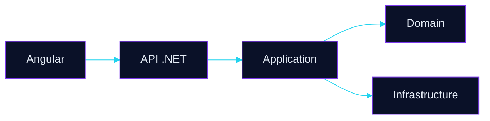

# Guía visual de GitHub — "El kraken en el océano nocturno"

Usuario: `MrKrakenGamez` · Perfil: https://github.com/MrKrakenGamez

## 0. Tokens de diseño (fuente de verdad)

| Token | Hex | Uso en GitHub |
|---|---|---|
| `BG` | `0A1128` | Fondo de cards/widgets, labelColor de badges |
| `BG_DEEP` | `05070F` | 2º color del gradiente de fondo, fin de waves |
| `VIOLET` | `7C3AED` | Bordes, color de mensaje en badges, línea de gráficas |
| `CYAN` | `22D3EE` | Títulos, anillos, iconos backend, acentos |
| `PURPLE` | `A855F7` | `icon_color`, fuego del streak, iconos frontend |
| `TEXT` | `E6EDF7` | Texto principal |
| `MUTED` | `94A3B8` | Etiquetas secundarias, fechas |
| Radio | `16` | Todos los widgets (`border_radius=16`) |
| Mono | JetBrains Mono | Typing SVG, banner (`$ whoami`) |
| Display | Space Grotesk | Banner (ver nota de fuentes) |

Regla de acento: **cyan = backend/infra, violeta = frontend/web**.

---

## 1. Tabla widgets → configuración exacta

Todas las URLs ya llevan tus hex. Base URL de stats: `https://github-readme-stats.vercel.app`.

| Widget | URL completa | Notas |
|---|---|---|
| Banner (principal) | `./assets/banner.svg` | SVG propio, 1600×400, animado |
| Banner (alterno) | `https://capsule-render.vercel.app/api?type=waving&height=240&color=0:05070F,50:7C3AED,100:22D3EE&text=Mike%20Kraken&fontColor=E6EDF7&fontSize=60&fontAlignY=38&desc=Full%20Stack%20%C2%B7%20DevOps%20%C2%B7%20Tech%20Lead&descAlignY=58&descSize=20&animation=fadeIn` | Fallback sin tocar archivos |
| Typing SVG | `https://readme-typing-svg.demolab.com?font=JetBrains+Mono&weight=500&size=20&duration=3200&pause=1100&color=22D3EE&center=true&vCenter=true&width=720&height=42&lines=Full+Stack+Developer;DevOps+%26+CI%2FCD;L%C3%ADder+T%C3%A9cnico;.NET+%2B+Angular+%2B+Clean+Architecture` | Líneas separadas por `;` |
| Stats | `https://github-readme-stats.vercel.app/api?username=MrKrakenGamez&show_icons=true&hide_border=false&include_all_commits=true&count_private=true&bg_color=135,0A1128,05070F&title_color=22D3EE&text_color=E6EDF7&icon_color=A855F7&border_color=7C3AED&ring_color=22D3EE&border_radius=16&locale=es` | `bg_color=135,hex,hex` = gradiente |
| Top lenguajes | `https://github-readme-stats.vercel.app/api/top-langs/?username=MrKrakenGamez&layout=compact&langs_count=8&hide_border=false&bg_color=135,0A1128,05070F&title_color=22D3EE&text_color=E6EDF7&border_color=7C3AED&border_radius=16&locale=es` | Sin `icon_color` (no aplica) |
| Streak | `https://streak-stats.demolab.com?user=MrKrakenGamez&background=0A1128&border=7C3AED&stroke=7C3AED&ring=22D3EE&fire=A855F7&currStreakNum=E6EDF7&currStreakLabel=22D3EE&sideNums=E6EDF7&sideLabels=94A3B8&dates=94A3B8&border_radius=16&hide_border=false&locale=es` | |
| Activity graph | `https://github-readme-activity-graph.vercel.app/graph?username=MrKrakenGamez&bg_color=0A1128&color=E6EDF7&line=7C3AED&point=22D3EE&area=true&area_color=7C3AED&title_color=22D3EE&hide_border=true&radius=16` | Extra, muy "dashboard" |
| Trofeos (opcional) | `https://github-profile-trophy.vercel.app/?username=MrKrakenGamez&theme=tokyonight&no-frame=true&no-bg=true&row=1&column=7&margin-w=12` | **No acepta hex**; `tokyonight` es el que más se acerca. Solo úsalo si tienes varios trofeos reales |
| Badge estándar | `https://img.shields.io/badge/{LABEL}-{VALOR}-7C3AED?style=flat-square&labelColor=0A1128&logo={slug}&logoColor=22D3EE` | Para tecnologías |
| Badge CTA | `...?style=for-the-badge&labelColor=0A1128&logo={slug}&logoColor=22D3EE` | Para enlaces del header |
| Iconos stack | `https://cdn.simpleicons.org/{slug}/22D3EE` (backend) · `/A855F7` (frontend) | Monocromo lineal, consistente |
| Contador visitas | `https://komarev.com/ghpvc/?username=MrKrakenGamez&label=VISITAS&color=7C3AED&labelColor=0A1128&style=for-the-badge` | |
| Footer | `https://capsule-render.vercel.app/api?type=waving&section=footer&height=140&color=0:22D3EE,50:7C3AED,100:05070F&reversal=true` | |
| Divider | `./assets/divider.svg` | SVG propio con olas animadas |

Slugs simple-icons usados: `dotnet`, `angular`, `typescript`, `microsoftsqlserver`, `postgresql`, `docker`, `githubactions`, `astro`, `react`, `threedotjs`, `tailwindcss`, `netlify`, `vercel`, `git`. Si un icono no aparece (simple-icons retira marcas de vez en cuando), usa un badge de texto o un SVG de lucide.dev recoloreado a `#22D3EE`.

---

## 2. Imágenes a generar

Principio: **la IA genera fondos y emblemas SIN texto**; el texto se pone después en Figma/Inkscape con Space Grotesk / JetBrains Mono. La IA falla con tipografía y rompe la consistencia.

| # | Imagen | Dimensiones | Formato | Ubicación |
|---|---|---|---|---|
| 1 | Avatar | 1024×1024 (sujeto en el 80 % central, GitHub lo recorta a círculo) | PNG | Settings → Profile picture |
| 2 | Banner | 1600×400 (se muestra ~830 px de ancho, 4:1) | **SVG** (ya incluido) | `assets/banner.svg` → arriba del README |
| 3 | Divider | 1000×40 | **SVG** (ya incluido) | `assets/divider.svg` → entre secciones |
| 4 | Social preview por repo | 1280×640 (margen seguro 40 px, <1 MB) | PNG | Repo → Settings → Social preview |
| 5 | Icono por proyecto | 256×256 | SVG (preferido) / PNG transparente | Header del README de cada repo |
| 6 | Fondo decorativo de repo (opcional) | 1280×320 | PNG/WebP | Header del README del repo si no usas capsule-render |

### Prompts (Midjourney / DALL·E / Stable Diffusion)

**1 · Avatar**
```
Minimalist geometric kraken emblem, front-facing, perfectly symmetrical, thin
linear tentacles forming a subtle "MK" monogram, deep navy background #0A1128,
glowing cyan #22D3EE and violet #7C3AED gradient line art, soft bioluminescent
glow, centered with generous padding, flat vector style, dark mode, no text
--ar 1:1 --style raw
```
SD negative: `text, letters, photo, realistic, busy background, 3d render, watermark`.
Prueba: debe leerse a 40×40 px. Si no, simplifica a cabeza + 3 tentáculos.

**2 · Banner raster alterno** (solo si prefieres imagen en vez del SVG)
```
Ultra-wide cinematic night ocean, abstract linear kraken tentacles rising from
the bottom right, glassmorphism light refractions, gradient from #05070F to
#0A1128, cyan #22D3EE and violet #A855F7 bioluminescent particles, large empty
negative space on the left for text, minimal, no text, no logos
--ar 4:1 --style raw
```
Exporta 2400×600 y superpón el texto en Figma.

**4 · Social preview (plantilla base, reutilizable)**
```
Dark abstract tech background, deep navy #0A1128 to #05070F gradient, subtle
violet #7C3AED glow top-right, cyan #22D3EE glow bottom-left, faint grid
pattern, soft glass panel shapes, tiny kraken tentacle silhouette in a corner,
very large negative space in the center, minimal, no text
--ar 2:1
```
Variantes por repo (añade al final):
- Portafolio: `floating 3D-like wireframe kraken, constellation lines`
- Backend .NET / API: `connected nodes and layered architecture rings`
- Angular / dashboard: `abstract UI cards and chart lines, glass panels`
- CI/CD / DevOps: `pipeline of glowing nodes flowing left to right`

Texto en Figma sobre la imagen: título en Space Grotesk 700 (`#E6EDF7`), subtítulo en JetBrains Mono (`#22D3EE`), una línea degradada cyan→violeta de 4 px bajo el título.

**5 · Iconos de proyecto**
Prefiere **lucide.dev** (misma familia lineal) exportado en SVG con `stroke="#22D3EE"`, `stroke-width="1.75"`, dentro de un cuadrado redondeado `rx=24` con fondo `#0A1128` y borde `#7C3AED` al 50 %. Si quieres IA:
```
Single app icon, rounded square glass card, dark navy #0A1128, thin 2px cyan
#22D3EE line icon of {CONCEPTO}, soft violet glow, flat vector, consistent
stroke, centered, no text --ar 1:1
```
Conceptos: `kraken + code brackets` (portafolio), `dumbbell + dashboard` (gym), `api nodes` (backend), `pipeline` (CI/CD).

**Fuentes en SVG:** GitHub no carga web fonts dentro de ``. El banner declara `'Space Grotesk','Inter','Segoe UI',system-ui` y caerá a la fuente del sistema. Para fijar la tipografía exacta: ábrelo en Inkscape/Figma → *Object to Path* → exporta SVG.

---

## 3. Repositorios

### 3.1 README template (copiar a cada repo)

````markdown
<div align="center">


</div>

## ⟡ Qué es
Una o dos frases. Sin relleno.

## ⟡ Stack
| Capa | Tecnología |
|---|---|
| Backend | .NET 8 · Clean Architecture |
| Frontend | Angular 20 |
| Datos | … |
| Infra | Docker · GitHub Actions |

## ⟡ Arquitectura


## ⟡ Inicio rápido
```bash
git clone https://github.com/MrKrakenGamez/NOMBRE-DEL-REPO
cd NOMBRE-DEL-REPO
```

## ⟡ Estructura
```text
src/
├─ Domain/
├─ Application/
├─ Infrastructure/
└─ Api/
```

<div align="center"><sub>Parte del ecosistema <a href="https://mikekraken.dev">Mike Kraken</a></sub></div>
````

Reglas: máximo 6 secciones, siempre con el prefijo `⟡`, una captura/GIF dentro de un `<table>` o con `border-radius` solo si usas `` (GitHub lo ignora; para esquinas redondeadas exporta la captura ya redondeada con fondo transparente).

### 3.2 Social preview (por repo)
1. Genera la base con el prompt #4 + la variante del repo.
2. En Figma (frame 1280×640): título, subtítulo mono, 3 badges tipográficos del stack, logo/icono 96 px abajo-izquierda.
3. Exporta PNG <1 MB → Repo → **Settings → General → Social preview → Edit**.

### 3.3 Topics y descripción
**Los topics de GitHub NO admiten emojis** (solo minúsculas, números y guiones). El emoji va en la **descripción** del repo.

- Descripción: `🐙 Descripción corta · .NET 8 + Angular` (un emoji al inicio, mismo patrón en todos).
- Topics consistentes: `dotnet` `csharp` `clean-architecture` `angular` `typescript` `docker` `github-actions` `devops` `portfolio` `astro`.

---

## 4. Extras del perfil

**Avatar:** prompt #1. Fondo `#0A1128`, sin texto.

**Bio (≤160 caracteres)** — ~125 usados:
```
Full Stack · DevOps · Tech Lead | .NET + Angular | Construyo sistemas que escalan desde las profundidades 🐙 | mikekraken.dev
```
Versión corta EN: `Full Stack · DevOps · Tech Lead | .NET + Angular | Building systems from the deep 🐙 | mikekraken.dev`
(Ajusta el dominio a `mikekraken.netlify.app` si aún no tienes el definitivo.)

**Status:** emoji `🐙` + `Construyendo en las profundidades` (o `Open to work` si estás buscando activamente).

**Pinned repos (6 máx., en este orden visual):**
1. Repo del portafolio (`mike-kraken`) — es tu carta de presentación, con el social preview más cuidado.
2. `GymAffiliate-Manager` — full-stack .NET 8 + Angular, demuestra el stack completo.
3. `MdaSolicitudes` — API en Clean Architecture; **solo si no contiene datos ni nombres de clientes** (tu portafolio público evita nombrarlos).
4. Un repo de pipeline/DevOps (CI/CD) — cubre el rol DevOps.
5. Un repo "playbook" sanitizado de migración legacy → .NET 8 — conecta con tu case study.
6. Un experimento Three.js/R3F — aporta el lado creativo.

Criterio estético: los 6 con **mismo patrón de descripción** (emoji + frase corta), social preview propio y README con la plantilla 3.1. Si no tienes 6 presentables, fija 4; mejor menos que repos sin pulir.

---

## 5. Gists y otros

- **Gists:** primera línea de descripción con `🐙 `, nombre de archivo en `kebab-case`, y un comentario de cabecera de 2 líneas con el mismo `⟡`. Para snippets en Markdown usa un encabezado `## ⟡ Título`.
- **Repos personales:** todos con la plantilla 3.1; si es experimental, añade el badge `status-experimental` en `A855F7`.
- **Repo especial:** el repo `MrKrakenGamez/MrKrakenGamez` contiene `README.md` + `assets/`.
- **Snake animado (opcional):** `.github/workflows/snake.yml`
```yaml
name: Generate snake
on:
  schedule: [{ cron: "0 0 * * *" }]
  workflow_dispatch:
permissions:
  contents: write
jobs:
  snake:
    runs-on: ubuntu-latest
    steps:
      - uses: Platane/snk/svg-only@v3
        with:
          github_user_name: ${{ github.repository_owner }}
          outputs: |
            dist/github-snake-dark.svg?color_snake=#22D3EE&color_dots=#0A1128,#4C1D95,#7C3AED,#A855F7,#22D3EE
      - uses: crazy-max/ghaction-github-pages@v3.1.0
        with:
          target_branch: output
          build_dir: dist
        env:
          GITHUB_TOKEN: ${{ secrets.GITHUB_TOKEN }}
```
Luego descomenta el bloque del snake en `README.template.md`.

---

## 6. Checklist paso a paso

1. [ ] Crea el repo **público** `MrKrakenGamez/MrKrakenGamez` con "Add a README".
2. [ ] Clona y copia: `README.template.md`, `theme.json`, `build-readme.mjs`, carpeta `assets/`.
3. [ ] Edita `theme.json`: `LINKEDIN_URL`, `EMAIL`, `SITE_URL` (dominio real).
4. [ ] Ejecuta `node build-readme.mjs` → genera `README.md`.
5. [ ] Haz commit y push; revisa en modo oscuro **y** claro.
6. [ ] Genera el avatar (prompt #1) y súbelo en Settings → Public profile.
7. [ ] Pega la bio y configura el status.
8. [ ] Fija (pin) los repos en el orden de la sección 4.
9. [ ] Aplica la plantilla 3.1 a cada repo fijado; añade descripción con emoji y topics.
10. [ ] Genera y sube un social preview por repo fijado.
11. [ ] (Recomendado) Despliega tu propia instancia de `github-readme-stats` en Vercel (ver notas) y cambia el dominio base.
12. [ ] (Opcional) Activa el workflow del snake y descomenta su bloque.
13. [ ] Revisa en móvil: ancho de tabla de stats, legibilidad del banner.
14. [ ] Si cambias un color: edita `theme.json` → `node build-readme.mjs` → push. (El `banner.svg` y `divider.svg` tienen los hex fijos; búscalos con "buscar y reemplazar".)

---

## 7. Variables reutilizables

Archivo `theme.json` + `build-readme.mjs` (incluidos). El template usa `{{VARIABLE}}` y el script falla si falta alguna. Variables disponibles: `GH_USER`, `BG`, `BG_DEEP`, `VIOLET`, `CYAN`, `PURPLE`, `TEXT`, `MUTED`, `RADIUS`, `FONT_MONO`, `SITE_URL`, `LINKEDIN_URL`, `EMAIL`, `TYPING_LINES`.

---

## 8. Limitaciones a tener presentes

- **Instancias públicas de Vercel** (`github-readme-stats`, activity-graph) se saturan y a veces muestran errores o datos desactualizados. Solución robusta: haz fork de [anuraghazra/github-readme-stats](https://github.com/anuraghazra/github-readme-stats), despliégalo en Vercel con tu token (`PAT_1`) y sustituye el dominio base en el template.
- **Stats solo cuenta lo que GitHub ve:** con `count_private=true` (que requiere instancia propia con PAT) incluirás contribuciones privadas; en la pública solo se cuentan públicas.
- **Glassmorphism real, hover y `backdrop-filter` no existen en Markdown de GitHub.** Lo emulamos con gradientes, bordes violeta y fondos translúcidos dentro de SVG. Las animaciones (typing, twinkle, olas) funcionan vía SVG/CSS embebido.
- **Topics sin emojis** (límite de GitHub), por eso el emoji va en la descripción.
- **Trofeos** no aceptan colores hex; trátalos como opcionales.
